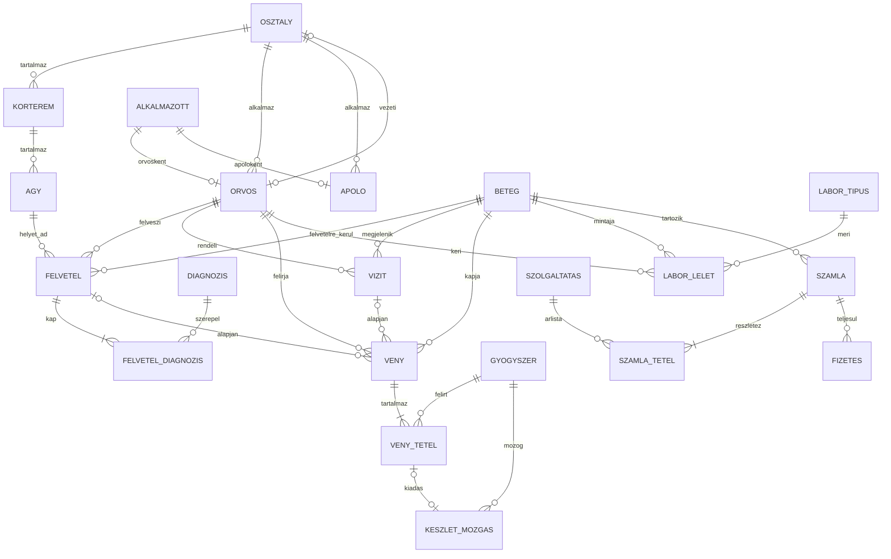

# Egyed-kapcsolat modell

Az azonosítók az adatbázisban ékezet nélkül szerepelnek. Az ábrán a jelentés olvasható.

## Egyedek

A modell hat csomag. A bemutatón így érdemes végigmondani, nem táblánként.

| Csomag | Egyedek | Miért külön egyed |
| --- | --- | --- |
| Szervezet | osztály, alkalmazott, orvos, ápoló | A dolgozó közös adata nem ismétlődik az altípusban. A pecsétszám csak orvosnál értelmes. |
| Elhelyezés | kórterem, ágy | Az ágy állapota és a terem az osztályé. Az ágyszám nem az osztály egy oszlopa. |
| Ellátás | beteg, felvétel, diagnózis, vizit | A diagnózis szótár. Egy felvételhez több diagnózis tartozik, egynek főnek kell lennie. |
| Gyógyszer | gyógyszer, vény, vénytétel, készletmozgás | A készlet eseményekből áll, nem egy felülírható mező. |
| Labor | labortípus, lelet | A referenciatartomány a vizsgálat típusáé, nem minden leletben ismétlődik. |
| Pénzügy | szolgáltatás, számla, számlatétel, fizetés | A számla több tételből és több részletfizetésből állhat. |

Az `audit_naplo` nem a klinika világa, hanem a rendszer nyoma. Az ER-ábrán ezért nincs rajta.

## Kapcsolatok, amiket szóban meg kell tudni védeni

- Egy alkalmazott legfeljebb egy orvos-sor és legfeljebb egy ápoló-sor. A kettő egyszerre tilos, ezt trigger zárja ki, mert két tábla között az idegen kulcs nem tudja.
- Egy osztálynak legfeljebb egy vezetője van, és egy orvos legfeljebb egy osztályt vezet. A vezető az adott osztály aktív orvosa.
- Az orvos pontosan egy osztályhoz tartozik. Emiatt a vizit táblában nincs `osztaly_id`: az osztály az orvosból következik.
- A felvétel osztálya az ágy, a kórterem, majd az osztály útvonalon érhető el. Külön osztálymező ellentmondásba kerülhetne az ággyal.
- A vény pontosan egy eseményhez kötött: vagy vizit, vagy felvétel. Mindkettő vagy egyik sem nem érvényes.
- A készletkiadás és a vénytétel között egy kiadás lehet. A bevételezésnek nincs vénytétel-párja.
- A számlatétel a szolgáltatás katalógusára mutat, de a nevet és az árat lemásolja. Ez szándékos. Ha a katalógus ára holnap változik, a tegnapi számla nem változhat.

## Nem tárolt, számolt adatok

Ezek nincsenek oszlopban, mert a többi adatból következnek:

- életkor
- ágyszám és kihasználtság
- gyógyszerkészlet
- számla bruttó végösszege és hátraléka
- a számlatétel bruttója generált oszlop a mennyiségből, a nettó árból és az áfából
